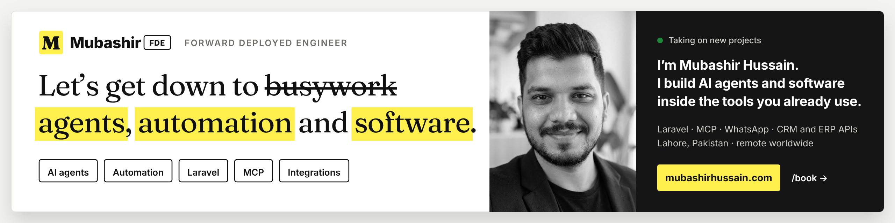

  

  
  
  
  
  
  

## Hi, I'm Mubashir

I'm a forward deployed engineer in Lahore, Pakistan. I work with businesses in the UK, UAE and US, and I build AI agents and software that save their teams hours.

Tell me what is slowing your team down and I'll build the fix inside the tools you already use. I learn how the business really runs, build inside its real systems, ship to production and keep improving it.

## What I build

- **AI agents and chatbots.** Assistants that answer customers, quote jobs and book appointments from your real data, with a person approving anything sensitive.
- **WhatsApp Business API.** The official WhatsApp Business setup: a shared inbox, approved templates and an AI assistant that answers 24/7.
- **MCP servers and connectors.** Let Claude, ChatGPT and other AI assistants use your data safely, with permissions and an audit log.
- **API and CRM/ERP integration.** Connect your CRM, ERP, booking and payment tools so data moves by itself, with alerts when something fails.
- **AI workflow automation.** Automate the repetitive work, like documents, follow-ups and lead routing, and keep a person on the risky steps.
- **Custom web apps.** Booking systems, dashboards, customer portals and business websites, mostly in Laravel, built around how your work is done.

## How working with me goes

1. **Tell me the problem.** Book a free call or message my AI agent on [my site](https://mubashirhussain.com). It asks the right questions and briefs me, so we start prepared.
2. **We agree the plan and price.** You get a clear scope, a timeline and a price before any work starts.
3. **I build and ship every week.** You see working progress each week and can change direction early. I stay on after launch to keep it running.

## Recent work

From my [case studies](https://mubashirhussain.com/field-reports):

- **[Running a UK repair business on one platform](https://mubashirhussain.com/field-reports/fone-doctors)**: I lead development of the platform fone doctors runs on: customers, devices and repairs, bookings, payments, invoices and trade-ins. *Laravel · MySQL · Vue.js · Tailwind CSS*
- **[The website where customers book a repair](https://mubashirhussain.com/field-reports/fone-doctors-website)**: customers find their device, see repair prices and book a repair. *Nuxt · Vue.js*
- **[An operating system for a repair business](https://mubashirhussain.com/field-reports/fone-doctors-ane)**: ANE, the private staff workspace behind the shop.
- **[A point-of-sale built for repair shops](https://mubashirhussain.com/field-reports/khadim-pos)**: Khadim POS, made for repair businesses rather than adapted from a retail till. *Laravel · Vue.js · MySQL*
- **[Online booking and shop for repair businesses](https://mubashirhussain.com/field-reports/repair-front)**: Repair Front, a WordPress theme with a booking wizard, online payments and order tracking. *WordPress · WooCommerce · PHP*
- **[A learning platform with secure video access](https://mubashirhussain.com/field-reports/sultan-academy)**: Sultan Academy Online, where students get secure access to video lectures. *Laravel · Vue.js · MySQL*
- **[A team of AI agents that answers customers](https://mubashirhussain.com/field-reports/this-website)**: the agent on my own site, a coordinator with specialist agents, each with only the tools it needs. *Laravel · LLM APIs · MCP*. [Try the AI demos →](https://mubashirhussain.com/demos)

More, including [CrawlReady AI](https://mubashirhussain.com/projects/crawlready-ai) (free AI SEO tools), are on my [work page](https://mubashirhussain.com/projects).

## Tech stack

  
  
  
  
  
  
  
  
  
  
  
  
  

  
  
  
  
  
  
  
  

## Latest writing

<!-- BLOG-POST-LIST:START -->
- [No-code vs custom code for small business: when to stop dragging boxes](https://mubashirhussain.com/blog/no-code-vs-custom-code-for-small-business)
- [MCP vs plain API integrations: what your business actually needs](https://mubashirhussain.com/blog/mcp-vs-plain-api-integrations)
- [WhatsApp bot vs website chat widget: where should your AI assistant live?](https://mubashirhussain.com/blog/whatsapp-bot-vs-website-chat-widget)
- [Freelancer vs agency vs in-house developer: who should build your software?](https://mubashirhussain.com/blog/freelancer-vs-agency-vs-in-house-developer)
- [AI voice agent vs receptionist vs IVR: who should answer your phone?](https://mubashirhussain.com/blog/ai-voice-agent-vs-receptionist-vs-ivr)
<!-- BLOG-POST-LIST:END -->

[Read all articles →](https://mubashirhussain.com/blogs)

---

  <b>Need something built for your business?</b> 
  I take on a few projects at a time. Tell me the problem and you get a clear plan, a fixed price or a weekly rate, and working progress every week.  
  <a href="https://mubashirhussain.com/book"><b>Book a free call</b></a> · <a href="mailto:hello@mubashirhussain.com">hello@mubashirhussain.com</a> · Lahore, Pakistan · remote worldwide

