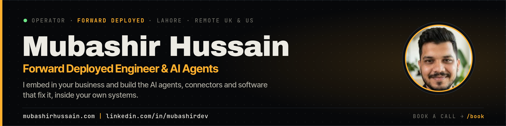

  

  

  
  
  

  
  

---

### `OPERATOR` · who I am

I'm **Mubashir Hussain**, a **forward deployed engineer** based in Lahore, Pakistan, working remotely with clients worldwide, including businesses in the **UK and US**.

**I embed in your business and build the AI agents, connectors and software that fix it, inside your own systems.** Instead of taking a spec and disappearing, I learn how your business really runs, build inside your real systems (integrations, automation, AI agents, internal tools), ship to production and stay on to improve it.

<table>
  <tr>
    <td align="center" width="25%"><b><code>01</code> Embed</b></td>
    <td align="center" width="25%"><b><code>02</code> Map</b></td>
    <td align="center" width="25%"><b><code>03</code> Build</b></td>
    <td align="center" width="25%"><b><code>04</code> Hand over</b></td>
  </tr>
</table>

### `CAPABILITIES` · what I build

| | |
|---|---|
| **01 · AI agents that finish tasks** | Agents that use tools wired to real data, with permissions, approvals and a log |
| **02 · Claude, ChatGPT and MCP connectors** | Extensions, bots, plugins, MCP connectors and Claude skills for your business systems |
| **03 · WhatsApp and Instagram automation** | WhatsApp Business, Instagram and Facebook Login integrations |
| **04 · Custom web platforms** | Laravel, Angular and Nuxt web apps and SaaS products |
| **05 · CRM, ERP and API integrations** | Connecting the systems you already run on |
| **06 · Booking, payments and operations** | The day-to-day systems a business runs on |

> [!NOTE]
> My agents read real data and never invent prices or stock. Sensitive actions such as payments, refunds and deletions need explicit human confirmation, and every action is logged.

### `MISSION LOG` · selected work

Taken from my [field reports](https://mubashirhussain.com/field-reports): work done inside real businesses. No results are claimed unless they were measured.

<table>
  <tr>
    <td width="50%" valign="top">
      <b><a href="https://mubashirhussain.com/field-reports/fone-doctors">Running a UK repair business on one platform</a></b> 
      Jul 2025 to present 
      I'm lead developer on the platform a repair business runs its day on: customers, devices and repairs, bookings, payments, invoices and trade-ins. 
      <code>Laravel</code> <code>MySQL</code> <code>Vue.js</code> <code>Tailwind CSS</code> <code>REST API</code>
    </td>
    <td width="50%" valign="top">
      <b><a href="https://mubashirhussain.com/field-reports/fone-doctors-website">The website where customers book a repair</a></b> 
      Jul 2025 to present 
      Customers find their device, see repair prices and book a repair, by post or in person. 
      <code>Nuxt</code> <code>Vue.js</code>
    </td>
  </tr>
  <tr>
    <td width="50%" valign="top">
      <b><a href="https://mubashirhussain.com/field-reports/fone-doctors-ane">An operating system for a repair business</a></b> 
      ANE is the private staff workspace behind the shop, an all-in-one operating system for device repair professionals and technical clinics.
    </td>
    <td width="50%" valign="top">
      <b><a href="https://mubashirhussain.com/field-reports/khadim-pos">A point-of-sale built for repair shops</a></b> 
      A POS and shop-management system made for repair businesses rather than adapted from a retail till. 
      <code>Laravel</code> <code>Vue.js</code> <code>MySQL</code> <code>Tailwind CSS</code>
    </td>
  </tr>
  <tr>
    <td width="50%" valign="top">
      <b><a href="https://mubashirhussain.com/field-reports/repair-front">Online booking and shop for repair businesses</a></b> 
      Jan 2025 to Apr 2026 
      Lets repair businesses take bookings and payments online without phone calls.
    </td>
    <td width="50%" valign="top">
      <b><a href="https://mubashirhussain.com/field-reports/sultan-academy">A learning platform with secure video access</a></b> 
      Administrators manage courses and video lectures, and students get secure access. 
      <code>Laravel</code> <code>PHP</code> <code>MySQL</code> <code>Vue.js</code>
    </td>
  </tr>
  <tr>
    <td colspan="2" valign="top">
      <b><a href="https://mubashirhussain.com/field-reports/this-website">A team of AI agents that answers customers</a></b> · 2026 
      The agent on my site is a coordinator and four specialists, each on its own model with only the tools it needs.
      <b><a href="https://mubashirhussain.com/demos">Try the live demos →</a></b> 
      <code>Laravel</code> <code>LLM APIs</code> <code>MCP</code> <code>Server-sent streaming</code>
    </td>
  </tr>
</table>

More systems, including [ComplyChase AI](https://mubashirhussain.com/projects/complychase-ai) and [CrawlReady AI](https://mubashirhussain.com/projects/crawlready-ai), are in my [systems registry](https://mubashirhussain.com/projects).

### `INSTRUMENTS` · tech stack

   
  

  
<b>Full stack breakdown</b>

   

| Area | Tools |
|---|---|
| **Backend** | Laravel, PHP, Livewire, MySQL, Python (FastAPI), REST APIs |
| **Frontend** | Vue.js, Nuxt, Angular, Tailwind CSS, JavaScript |
| **AI and automation** | LLM APIs, Model Context Protocol (MCP), multi-agent systems, server-sent streaming |
| **CMS** | WordPress, WooCommerce |
| **Tooling** | Git, GitHub, GitLab, Laravel Forge |

### `TELEMETRY` · activity

  
  

  

Most client work lives in private repos, so public numbers show only part of it.

### `DISPATCHES` · latest articles

| Date | Article |
|---|---|
| 25 Oct 2026 | [Your AI agent doesn't need an org chart: what Anthropic's advice on subagents means for your build](https://mubashirhussain.com/blog/your-ai-agent-doesnt-need-an-org-chart-what-anthropics-advice-on-subagents-means-for-your-build) |
| 24 Oct 2026 | [Stop giving AI agents your passwords: what the US bank lockout means for your business](https://mubashirhussain.com/blog/stop-giving-ai-agents-your-passwords-what-the-us-bank-lockout-means-for-your-business) |
| 23 Oct 2026 | [Why a business agent must never invent prices](https://mubashirhussain.com/blog/why-a-business-agent-must-never-invent-prices) |

More dispatches from the field on [mubashirhussain.com/blog](https://mubashirhussain.com/blog) ([RSS](https://mubashirhussain.com/rss.xml)).

### `TRANSMIT` · contact

> **What needs fixing? [Book a call →](https://mubashirhussain.com/book)**
> A short call to hear what you're trying to fix. You get a calendar invite with a Google Meet link.

  
  
  
  
  
  

mubashirhussain.com | linkedin.com/in/mubashirdev · Lahore, Pakistan · remote worldwide

